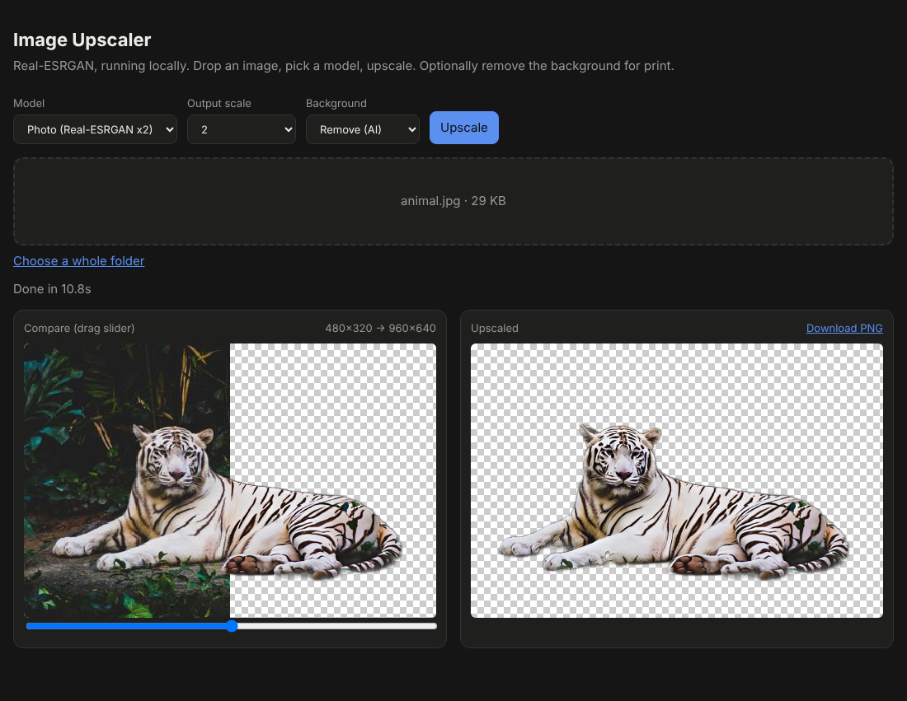
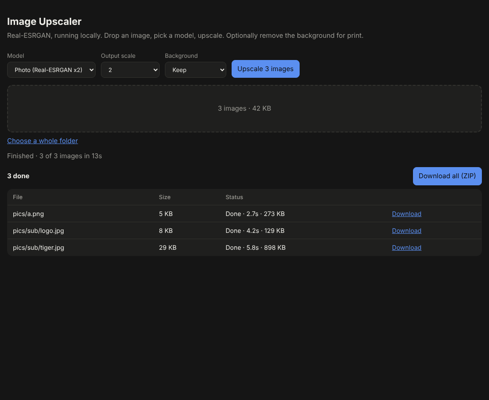

# Image Upscaler

AI image upscaling and background removal that runs on your own computer.
Use it from a web page in your browser, or from the terminal for whole folders.

- **Upscale** 2×, 3× or 4× with Real-ESRGAN (photo and anime/illustration models)
- **Remove backgrounds** for print: AI cut-out, or make one colour transparent
- **Batch**: many images or whole folders, with a ZIP download or written straight to disk
- Works offline after the first run. Your images never leave your machine.



---

## Contents

1. [Requirements](#requirements)
2. [Install](#install)
3. [Start the app](#start-the-app)
4. [Using the web page](#using-the-web-page)
5. [Choosing settings](#choosing-settings)
6. [Background removal](#background-removal)
7. [Batch: many images or a folder](#batch-many-images-or-a-folder)
8. [Command line](#command-line)
9. [Preparing images for print](#preparing-images-for-print)
10. [Speed and hardware](#speed-and-hardware)
11. [Configuration](#configuration)
12. [Output files](#output-files)
13. [Troubleshooting](#troubleshooting)
14. [How it works](#how-it-works)
15. [HTTP API](#http-api)
16. [Files in this folder](#files-in-this-folder)

---

## Requirements

- **Python 3.9 or newer.** Check with `python3 --version`.
- **About 2.5 GB free disk:** PyTorch is 1–2 GB, and the models are about 330 MB in total.
- macOS, Windows or Linux. A graphics card is optional (see [Speed and hardware](#speed-and-hardware)).

## Install

Do this once. It needs internet.

```bash
git clone https://github.com/falseneutral/labs.git
cd "labs/CLAUDE OUTPUTS/Upscaler"     # quotes needed: the folder name has a space

python3 -m venv venv                  # private Python environment for this app
source venv/bin/activate              # Windows: venv\Scripts\activate
pip install -r requirements.txt
```

Once it's activated, your prompt starts with `(venv)`.

**Already installed and pulled an update?** Activate the venv and run
`pip install -r requirements.txt` again. New features sometimes add packages.

## Start the app

```bash
cd "labs/CLAUDE OUTPUTS/Upscaler"
source venv/bin/activate              # every new terminal window
python app.py
```

Open **http://localhost:7860** in your browser. Stop the app with **Ctrl+C** in the terminal.

The terminal shows what it's doing, for example `tile 12/48 · ~90s left`.

**First use downloads models** to the `weights/` folder. This happens once per model:

| Model | Download | Used for |
|---|---|---|
| Photo x4 | 67 MB | Upscaling photos |
| Photo x2 | 67 MB | Upscaling photos, faster |
| Anime x4 | 18 MB | Upscaling illustrations |
| ISNet background remover | 170 MB | Background: Remove (AI) |

---

## Using the web page

1. **Pick settings** in the top row: Model, Output scale, Background.
2. **Add images.** Drop them onto the box, click the box to choose files,
   or click **Choose a whole folder**.
3. Click **Upscale** (the button says **Upscale 12 images** when you add several).
4. Watch the progress bar. It shows percent, tile count and time left.
5. **Download** the result.

**One image** shows a before/after comparison. Drag the slider to compare,
then click **Download PNG**.

**Several images** show a list instead (see [Batch](#batch-many-images-or-a-folder)).

Transparent areas are shown as a grey-and-white checkerboard.

## Choosing settings

### Model

| Model | Best for | Speed |
|---|---|---|
| **Photo (x4)** | Photos, general images, big enlargements | Slowest |
| **Photo (x2)** | Photos when you only need 2× | About 4× faster than x4 |
| **Anime / illustration (x4)** | Drawings, cartoons, line art, flat-colour graphics | Fast |

Use the Anime model only for drawn images. On photos it gives a painted look.

### Output scale

| Scale | Result |
|---|---|
| **1 (no upscale)** | Same size. Use it to remove a background only. |
| **2** | Twice the width and height |
| **3** | Three times |
| **4** | Four times |

Each model works at its own scale (2× or 4×), and the result is then resized to the
scale you pick. So **for 2× output, choose Photo (x2)**. Using a 4× model and
shrinking to 2× gives the same quality but takes about 4× longer. Choosing
Photo (x2) sets the scale to 2 automatically.

## Background removal

Set **Background** before you click Upscale. The result is a PNG with a
transparent background.

### Remove (AI)

Finds the main subject (person, product, animal, object) and removes everything else.
It works on any background, including busy ones.

- Best for photos of people, products and pets.
- Struggles with very fine detail like loose hair or fur, glass, and smoke.
  Check the edges before printing.
- The first use downloads 170 MB.

### Remove colour

Makes one colour transparent. It's instant and exact, and best for **logos, scans,
screenshots and flat backgrounds**.

| Control | What it does |
|---|---|
| **Colour** | The colour to remove. Default white. Click to pick another. |
| **Tolerance** | How close a colour must be to count as a match (0–60). Raise it if a halo or patchy background is left. Lower it if parts of the subject disappear. Start at 10. JPEGs usually need 15–25. |
| **Only from edges** | On: only removes the colour where it connects to the image border, so white *inside* a logo (eyes, letter holes) stays. Off: removes that colour everywhere. |

### Order of operations

The background is removed on the original image first, then the image and its
transparency are upscaled together. Edges stay smooth at print size.

---

## Batch: many images or a folder

### In the web page

- Drop several images, drop a folder, or click **Choose a whole folder**.
  Subfolders are included. Non-image files and hidden files are ignored.
- Images run one at a time, all with the same settings.
- The list shows each file's status, time taken and output size, and a **Download** link.
- **Stop after this image** finishes the current image and skips the rest.
- **Download all (ZIP)** saves every finished image, keeping the folder structure.

**Limits:** the browser holds all results in memory, and one ZIP can't be bigger
than 4 GB. For hundreds of images or very large photos, use the command line.



### Supported formats

PNG, JPG/JPEG, WebP, BMP, TIFF and GIF (first frame). Output is always PNG.

---

## Command line

Batch mode writes results straight to a folder, so there are no memory or ZIP limits.
Activate the venv first.

```bash
python app.py --batch FOLDER [options]
```

| Option | Default | Meaning |
|---|---|---|
| `--batch FOLDER` | — | Folder to process, including subfolders |
| `--out FOLDER` | `FOLDER_upscaled` | Where results go. Subfolders are mirrored. |
| `--model` | `photo-x4` | `photo-x4`, `photo-x2` or `anime-x4` |
| `--scale` | `4` | Output scale, 1–8 |
| `--bg` | `none` | `none`, `ai` or `color` |
| `--bg-color` | `#ffffff` | Colour to remove with `--bg color` |
| `--tolerance` | `10` | Colour tolerance, 0–60 |
| `--all-colour` | off | Remove the colour everywhere, not just from the edges |
| `--overwrite` | off | Redo images that already exist in the output folder |

Without `--overwrite`, images already in the output folder are skipped, so you can
stop with **Ctrl+C** and run the same command again to carry on.

### Examples

```bash
# Upscale a whole shoot 4×  →  ~/Pictures/shoot_upscaled
python app.py --batch ~/Pictures/shoot

# Faster 2×, results on the Desktop
python app.py --batch ~/Pictures/shoot --model photo-x2 --scale 2 --out ~/Desktop/shoot_2x

# Product photos: cut out and upscale 2×
python app.py --batch ./products --model photo-x2 --scale 2 --bg ai

# Logos on white: make white transparent, no upscale
python app.py --batch ./logos --scale 1 --bg color --bg-color "#ffffff" --tolerance 20

# Illustrations 4×
python app.py --batch ./art --model anime-x4
```

`python app.py --help` lists every option.

---

## Preparing images for print

**How many pixels do you need?** Print width (inches) × 300 = pixels for sharp print
(150 is fine for posters seen from a distance).

| Print size | Pixels needed at 300 DPI |
|---|---|
| 4 × 6 in | 1200 × 1800 |
| 8 × 10 in | 2400 × 3000 |
| A4 (8.3 × 11.7 in) | 2480 × 3508 |
| A3 (11.7 × 16.5 in) | 3508 × 4961 |

Divide the pixels you need by your image's current pixels, then pick the next scale up.

**DPI setting:** output PNGs don't record a DPI. Set the print size in your print
dialog or layout app (Preview, Photoshop, Canva, InDesign), or tell the print shop
the size you want.

**Transparency:** keep the PNG for printers and print shops that accept it
(stickers, DTF/DTG shirts, cut vinyl). If a shop asks for PDF or TIFF, convert the
PNG and keep the transparency. Flattening onto white loses the cut-out.

---

## Speed and hardware

The app picks the fastest device automatically. The web page and terminal show
which one it's using (`CPU`, `MPS` or `CUDA`).

| Device | Used on |
|---|---|
| **MPS** | Macs with Apple Silicon (M1 and later) |
| **CUDA** | PCs with an NVIDIA graphics card |
| **CPU** | Everything else. Works, but slower. |

Rough CPU times measured on a 4-core machine:

| Job | Time |
|---|---|
| 300×200 image, Photo x4 | ~10 s |
| 640×512 image, Anime x4 | ~23 s |
| 480×320 image, Photo x2 + AI background | ~8 s |

Time grows with the number of pixels. A 12-megapixel phone photo at 4× on CPU can
take many minutes. Tips:

- Use **Photo (x2)** when 2× is enough.
- Shrink huge photos before upscaling if they're already big enough to print.
- Background removal adds a few seconds per image, whatever the size.

---

## Configuration

Set these before `python app.py`, for example `PORT=8000 python app.py`.

| Variable | Default | Meaning |
|---|---|---|
| `PORT` | `7860` | Web page port |
| `DEVICE` | auto | Force `cpu`, `mps` or `cuda` |
| `TILE` | `256` | Tile size in pixels. Lower (e.g. `128`) uses less memory; higher can be faster on big GPUs. |
| `MAX_INPUT_PX` | `36000000` | Largest input in pixels (6000×6000). Raise it for bigger images, e.g. `MAX_INPUT_PX=100000000`. |
| `WEIGHTS_DIR` | `./weights` | Where models are stored |

Other fixed limits: the web page accepts uploads up to 50 MB each, and output scale is 1–8.

**Network access:** the app listens on all network interfaces, so other devices on
your Wi-Fi can open it at `http://<your-computer's-IP>:7860`. That's handy for
using it from a phone. Don't run it on untrusted networks.

---

## Output files

| Case | Filename |
|---|---|
| Upscale | `photo_x4.png` |
| Upscale + background removed | `photo_x2_transparent.png` |
| Background only (scale 1) | `photo_x1_transparent.png` |

All output is PNG. That keeps it lossless and keeps any transparency.

---

## Troubleshooting

| Problem | Fix |
|---|---|
| `bad interpreter` / `/Library/Python/2.7/bin/pip` | You're using an old system pip. Run `source venv/bin/activate` first, or use `python -m pip`. |
| `ModuleNotFoundError: No module named '…'` | Activate the venv, then `pip install -r requirements.txt` |
| `Image too large (max … pixels)` | Start with a higher limit: `MAX_INPUT_PX=100000000 python app.py` |
| `413 Request Entity Too Large` with no message | The file is over 50 MB. Use the command line, or convert it to JPG first. |
| Very slow | Check the device shown on the page. On CPU, use Photo (x2), smaller images, or a Mac/NVIDIA GPU. |
| Errors mentioning `mps` on a Mac | Run `DEVICE=cpu python app.py` |
| Out of memory / crash on big images | Run `TILE=128 python app.py` |
| `Address already in use` | The app is already running in another terminal, or something else uses the port: `PORT=7861 python app.py` |
| Stuck on "Loading model" the first time | The model is downloading (up to 170 MB). The terminal shows `Downloading …`. |
| AI cut-out misses parts or leaves background | Try Remove colour if the background is flat. Otherwise touch up the PNG in an editor. |
| Colour removal leaves a halo | Raise Tolerance. For JPEGs, try 15–25. |
| Colour removal eats into the subject | Lower Tolerance, and turn on **Only from edges** |
| Dragging a folder doesn't work | Use **Choose a whole folder** instead |
| `WARNING: You are using pip version …` | Harmless. Optional: `pip install --upgrade pip` |

---

## How it works

- **Upscaling:** [Real-ESRGAN](https://github.com/xinntao/Real-ESRGAN) models, loaded
  with [spandrel](https://github.com/chaiNNer-org/spandrel) on PyTorch. Images are
  processed in 256-pixel tiles, each with 16 pixels of overlap so seams don't show,
  which keeps memory use flat for any image size. Tiles are assembled in normal
  memory, not GPU memory. If the output scale differs from the model's, the result
  is resized with Lanczos.
- **AI background removal:** the ISNet "general use" model from
  [rembg](https://github.com/danielgatis/rembg), run with ONNX Runtime at
  1024×1024. The mask is scaled back to the image size.
- **Colour removal:** each pixel's distance from the chosen colour, with a soft edge
  just above the tolerance. "Only from edges" keeps only the regions that connect
  to the image border (SciPy connected components).
- **Transparency:** existing transparency in the input is kept. The mask and the
  image are upscaled together.
- **Web page:** a single HTML file with no external dependencies. The ZIP is built in the browser.

## HTTP API

The web page uses these endpoints. They can also be scripted.

| Method | Path | Purpose |
|---|---|---|
| `GET` | `/` | The web page |
| `GET` | `/api/info` | `{"device": "mps", "models": [...]}` |
| `POST` | `/api/upscale` | Multipart form: process one image, returns PNG |
| `GET` | `/api/progress/<job>` | `{"done", "total", "eta"}` or `{"stage"}` for a running job |

`/api/upscale` form fields:

| Field | Values | Default |
|---|---|---|
| `image` | file | required |
| `model` | `photo-x4`, `photo-x2`, `anime-x4` | `photo-x4` |
| `scale` | 1–8 | `4` |
| `bg` | `none`, `ai`, `color` | `none` |
| `bg_color` | `#rrggbb` | `#ffffff` |
| `tolerance` | 0–100 | `10` |
| `edges_only` | `1` / `0` | `0` |
| `job` | any id, for polling progress | — |

```bash
curl -F image=@photo.jpg -F model=photo-x2 -F scale=2 -F bg=ai \
     http://localhost:7860/api/upscale -o photo_x2_transparent.png
```

## Files in this folder

| File | What it is |
|---|---|
| `app.py` | Server, models, command line |
| `index.html` | Web page |
| `requirements.txt` | Python packages |
| `weights/` | Downloaded models (created on first use, not in git) |
| `screenshot.png`, `screenshot-batch.png` | Images used in this guide |
| `CLAUDE.md` | Maintenance note: keep this README in sync with code changes |
